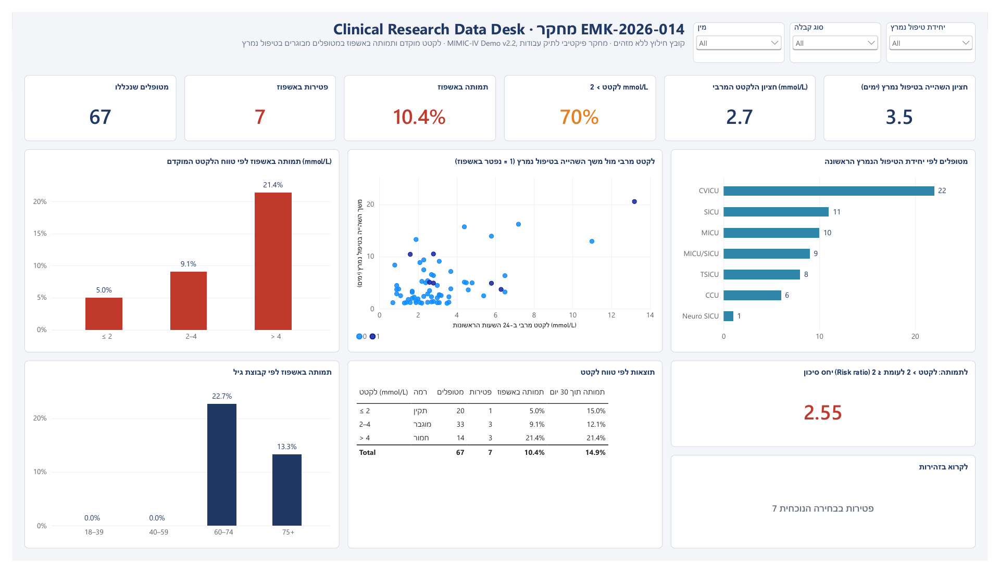
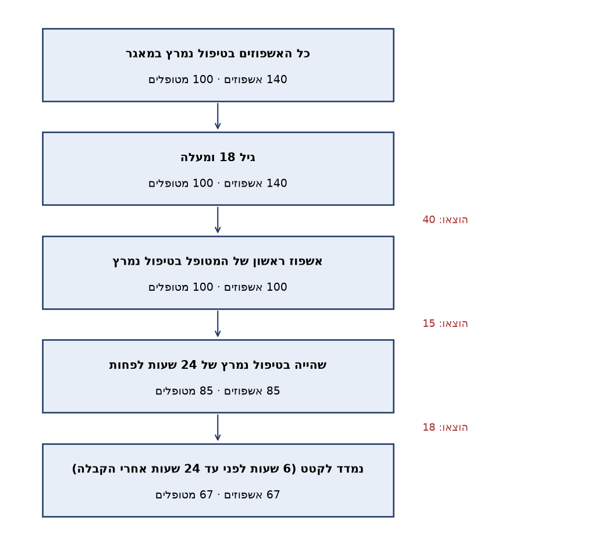
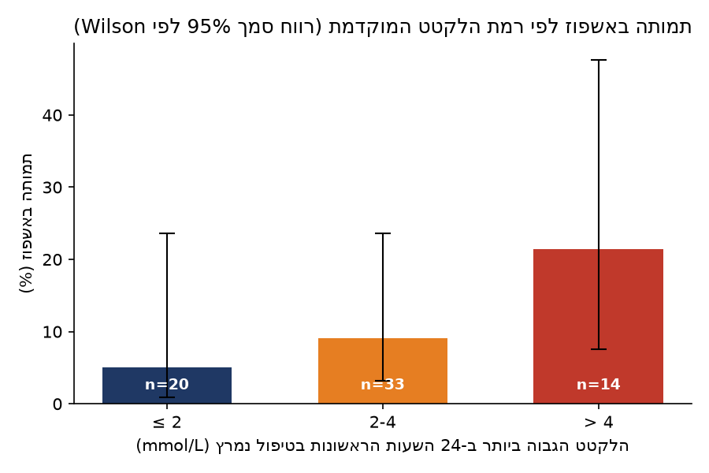
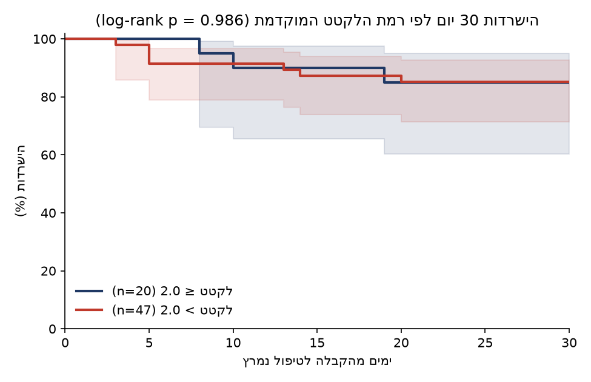
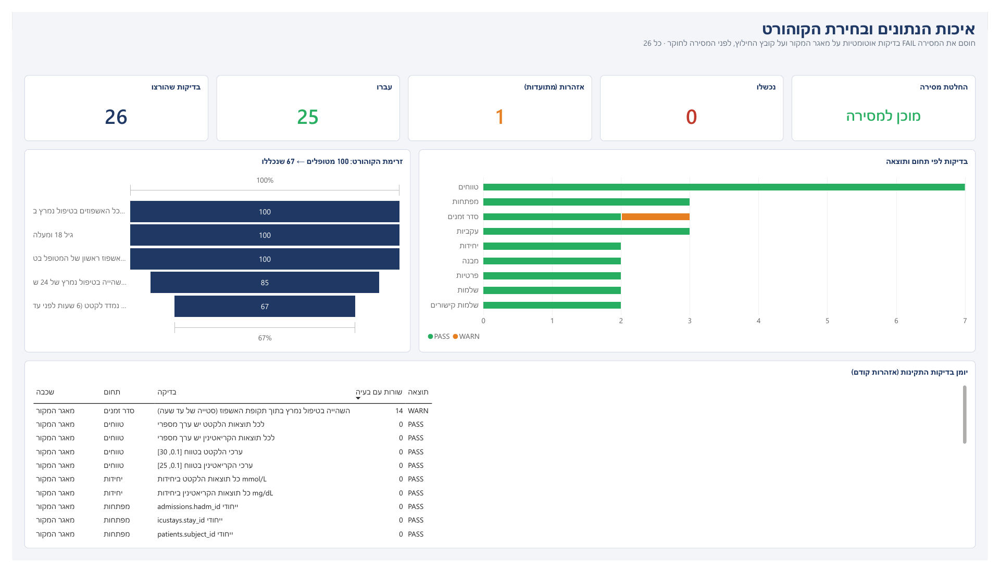

<div dir="rtl">

🌐 **עברית** | [English](README.en.md)

# 🏥 Clinical Research Data Desk

**תהליך עבודה מלא על נתוני מחקר, על נתוני בית חולים אמיתיים (לאחר הסרת מזהים)**: בדיקת היתכנות (Feasibility) להצעת מחקר, חילוץ נתונים ב-SQL לפי פרוטוקול כולל הסרת מזהים (De-identification), בדיקות תקינות נתונים אוטומטיות (Data validation), ניתוח סטטיסטי, ודשבורד Power BI על מודל סכמת כוכב (Star schema). הכול ב-Python, SQL ו-DAX.

הפרויקט משחזר את העבודה של אנליסט נתוני מחקר בבית חולים: חוקר מגיש פרוטוקול מחקר, וצוות הנתונים בודק אם המחקר ישים, מחלץ בדיוק את הנתונים שאושרו, מוודא את תקינותם ותומך בניתוח.

**נתונים:** [MIMIC-IV Clinical Database Demo v2.2](https://physionet.org/content/mimic-iv-demo/2.2/): 100 מטופלי טיפול נמרץ (ICU) לאחר הסרת מזהים, מהמרכז הרפואי Beth Israel Deaconess (275 אשפוזים, 140 שהיות בטיפול נמרץ, 107,727 תוצאות מעבדה).



---

## בקשת המחקר

> **EMK-2026-014 (הצעת מחקר פיקטיבית, שנכתבה עבור פרויקט תיק העבודות הזה):** האם רמת לקטט גבוהה בדם ב-24 השעות הראשונות של שהייה בטיפול נמרץ קשורה לתמותה במהלך האשפוז, לאחר תקנון לגיל ולמין?

הפרוטוקול כולו (קריטריוני הכללה, מזהי בדיקות מעבדה, חלונות זמן, טווחים סבירים ומשתנים מאושרים) נמצא בקובץ [`protocol/lactate_mortality.yaml`](protocol/lactate_mortality.yaml). אף פרמטר לא מקודד ישירות ב-SQL או ב-Python, כך שמחקר חדש פירושו קובץ YAML חדש.

## תהליך העבודה והתוצאות

| שלב | מה הוא עושה | תוצר |
|---|---|---|
| **1. בדיקת היתכנות** | מפעיל את הקריטריונים אחד אחרי השני, סופר מטופלים ואירועי תוצאה, בודק אירועים למשתנה (EPV) ושלמות נתונים, ונותן המלצה | [`01_feasibility.md`](reports/01_feasibility.md) |
| **2. חילוץ** | שאילתת SQL אחת עם פרמטרים, ואחריה הסרת מזהים: מזהי מחקר מחליפים את מזהי בית החולים (מפתח הקישור נשמר בנפרד), תאריכים הופכים ל"ימים מהקבלה לטיפול נמרץ", גילאים מעל 89 מקובצים, ורק המשתנים שאושרו יוצאים (עיקרון המינימום ההכרחי, Minimum necessary) | קובץ CSV + [מילון נתונים](data/extract/EMK-2026-014_data_dictionary.md) |
| **3. בדיקות תקינות** | 26 בדיקות אוטומטיות על מאגר המקור (מפתחות, שלמות קישורים, סדר זמנים, יחידות, טווחים) ועל קובץ החילוץ (פרטיות, מבנה, טווחים). כל FAIL חוסם את המסירה | [`02_validation.md`](reports/02_validation.md) |
| **4. ניתוח** | רץ רק על קובץ החילוץ שנמסר: טבלה 1 (Table 1) עם מבחני מובהקות, תמותה לפי טווח לקטט, רגרסיה לוגיסטית (Logistic regression) בשיטת נראות מרבית (ML) ובשיטת Firth, ועקומות Kaplan-Meier עם מבחן log-rank | [`03_analysis.md`](reports/03_analysis.md) |
| **5. ייצוא ל-BI** | בונה סכמת כוכב קטנה (טבלת עובדות של מטופלים + ממדים של טווח לקטט, קבוצת גיל ויחידת טיפול נמרץ, ועוד טבלאות של זרימת הקוהורט ושל יומן הבדיקות) עבור הדשבורד. הטווחים והתוויות נקבעים פעם אחת, ב-Python, ו-Power BI רק מבצע אגרגציה | `bi/data/*.csv` ← [פרויקט Power BI](bi/) |

### ממצאים עיקריים

- **היתכנות:** מתוך 100 מטופלים, **67 עומדים בקריטריונים** (שהייה ראשונה בטיפול נמרץ, 24 שעות לפחות, לקטט נמדד). יש רק **7 פטירות באשפוז**, כלומר 1.8 אירועים לכל משתנה במודל, ולכן ההמלצה היא *ישים בהסתייגויות*: נעשה שימוש במודל מצומצם וברגרסיה עם ענישה לפי Firth.
- **יחס מינון-תגובה (Dose-response):** התמותה באשפוז הייתה **5%** כשהלקטט ≤ 2, **9%** בטווח 2–4 ו-**21%** מעל 4 mmol/L.
- **מודל מתוקנן:** כל עלייה של 1 mmol/L בלקטט נתנה יחס סיכויים (OR) של **1.30 (רווח סמך 95% (95% CI) 0.97–1.74, p = 0.079)**. לקטט > 2: OR 2.36 (0.36–15.55). הכיוון תואם את הספרות הקלינית, אבל קוהורט (Cohort) הדמו קטן מכדי להגיע למובהקות.
- **בדיקות תקינות:** 0 כשלים. אזהרה אחת מתועדת: 14 שהיות בטיפול נמרץ מסתיימות עד 27 שעות אחרי השחרור מבית החולים (עיכוב בתיעוד, שלא משפיע על חלון 24 השעות הראשונות).

<p>
  
  
  
</p>

## דשבורד Power BI

דוח בן שני עמודים שנבנה כ-**Power BI Project (PBIP)**, כך שהמודל וכל ה-measures הם טקסט רגיל שאפשר לסקור ב-git ([`bi/ClinicalResearchDesk.SemanticModel/definition/`](bi/ClinicalResearchDesk.SemanticModel/definition/)).

- **מודל:** סכמת כוכב עם קשרי יחיד-לרבים (One-to-many) מ-`fact_patient` לשלושה ממדים. עמודות הטווחים ממוינות לפי עמודת סדר מוסתרת, כך ש"≤ 2 / 2–4 / > 4" אף פעם לא ממוינים לפי סדר אלפביתי.
- **20 measures ב-DAX**, למשל `Mortality %`, `Risk Ratio (High vs Normal)` (`CALCULATE` עם ארגומנטים של סינון), `Retained %` למשפך הקוהורט (`REMOVEFILTERS`), ו-`Release Decision` מתוך יומן הבדיקות.
- **אזהרה מובנית:** ה-measure `Sample Size Note` מתריע כשבחירה בסלייסרים משאירה פחות מ-5 פטירות, כדי שהדשבורד לא יזמין מסקנות שהנתונים לא יכולים לתמוך בהן.
- **עמוד 1, סקירת המחקר:** מדדי מפתח (KPI), תמותה לפי טווח לקטט ולפי קבוצת גיל, לקטט מול משך השהייה בטיפול נמרץ לכל מטופל, טבלת תוצאות, וסלייסרים למין, לסוג הקבלה וליחידת הטיפול הנמרץ.
- **עמוד 2, איכות נתונים:** כל 26 בדיקות התקינות, עבר/אזהרה/נכשל לפי תחום, משפך הקוהורט (100 ← 67) והחלטת המסירה.



## החלטות תכנון

- **בדיקות מעבדה מותאמות לפי מטופל וחלון זמן, ולא לפי מזהה אשפוז.** לבדיקות שנלקחו במיון לפני הקבלה לאשפוז יש לעיתים קרובות `hadm_id` ריק, וצירוף לפיו היה משמיט אותן בשקט.
- **שהייה אחת בטיפול נמרץ לכל מטופל** (הראשונה), כך שהתצפיות בלתי תלויות.
- **סינון לפי טווח סביר** ב-SQL. ערכים שנפסלו נספרים ומדווחים, ואף פעם לא נמחקים בשקט.
- **רגרסיה לוגיסטית לפי Firth** לצד נראות מרבית רגילה: כשיש מעט אירועים, האומדנים הרגילים מוטים הרחק מ-1 ולפעמים לא מתכנסים.
- **הניתוח קורא רק את קובץ החילוץ**, בדיוק כמו חוקר חיצוני, כך שכל תוצאה ניתנת לשחזור מהקובץ שנמסר.
- **הסטטיסטיקה מומשה ב-NumPy/SciPy** (רגרסיה לוגיסטית, תיקון Firth, Kaplan-Meier, log-rank, רווח סמך לפי Wilson) ונבדקת ב[בדיקות יחידה](tests/test_stats_utils.py) מול מקורות בלתי תלויים: scikit-learn, מבחן log-rank ורווח הסמך של Wilson ב-SciPy, אופטימיזציה ישירה של הנראות עם הענישה של Firth, ודוגמאות שחושבו ידנית. הבדיקות רצות בכל push (GitHub Actions).

## מבנה הפרויקט

</div>

```
clinical-research-data/
├── protocol/lactate_mortality.yaml   # הצעת המחקר כפרמטרים
├── sql/candidate_stays.sql           # שאילתת קוהורט עם פרמטרים, דגל לכל קריטריון
├── src/
│   ├── load_data.py                  # 0. ZIP → SQLite (קורא ישירות מה-ZIP)
│   ├── feasibility.py                # 1. זרימת קריטריונים, אירועים, EPV, המלצה
│   ├── extract.py                    # 2. חילוץ ללא מזהים, מינימום הכרחי
│   ├── validate.py                   # 3. בדיקות על המקור ועל החילוץ, שער מסירה
│   ├── analysis.py                   # 4. טבלה 1, רגרסיה, הישרדות, גרפים
│   ├── export_bi.py                  # 5. סכמת כוכב ל-Power BI
│   ├── stats_utils.py                # לוגיסטית / Firth / Kaplan-Meier / log-rank / Wilson
│   └── common.py
├── bi/
│   ├── ClinicalResearchDesk.pbip     # לפתוח ב-Power BI Desktop
│   ├── ClinicalResearchDesk.SemanticModel/   # טבלאות, קשרים, DAX (TMDL)
│   ├── ClinicalResearchDesk.Report/          # עמודי הדוח (PBIR)
│   ├── make_report.py                # מייצר את עמודי הדוח ממפרט פריסה
│   └── data/                         # קובצי ה-CSV של סכמת הכוכב, נכתבים בשלב 5
├── tests/test_stats_utils.py
├── reports/                          # דוחות וגרפים שנוצרו
└── run_pipeline.py
```

<div dir="rtl">

## הרצה

1. מורידים את קובץ ה-ZIP מ[עמוד הדמו של MIMIC-IV](https://physionet.org/content/mimic-iv-demo/2.2/) (גישה פתוחה) לתיקייה `data/raw/`. לא לחלץ אותו.
2. מריצים:

</div>

```bash
pip install -r requirements.txt
python run_pipeline.py              # כל השלבים
python run_pipeline.py feasibility  # או שלב בודד
pytest                              # בדיקות יחידה (pip install -r requirements-dev.txt)
```

<div dir="rtl">

3. פותחים את `bi/ClinicalResearchDesk.pbip` ב-Power BI Desktop. אם התיקייה שלכם שונה, מגדירים את הפרמטר `DataFolder` (Transform data ← Edit parameters) לנתיב של `bi/data` ולוחצים Refresh.

## רישיון הנתונים

MIMIC-IV Clinical Database Demo זמין תחת הרישיון Open Data Commons Open Database License v1.0. הנתונים הגולמיים וקובצי החילוץ ברמת המטופל לא נשמרים במאגר הזה.

הצעת המחקר, החוקר והאישור בפרויקט הזה פיקטיביים. הפרויקט הוא תיק עבודות אישי, ואינו קשור לבית חולים או למוסד מחקר כלשהו, ואינו מאושר על ידם.

> Johnson, A., Bulgarelli, L., Pollard, T., Horng, S., Celi, L. A., & Mark, R. (2023). *MIMIC-IV Clinical Database Demo* (version 2.2). PhysioNet. https://doi.org/10.13026/dp1f-ex47

</div>
