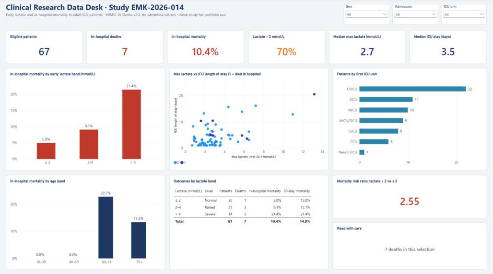
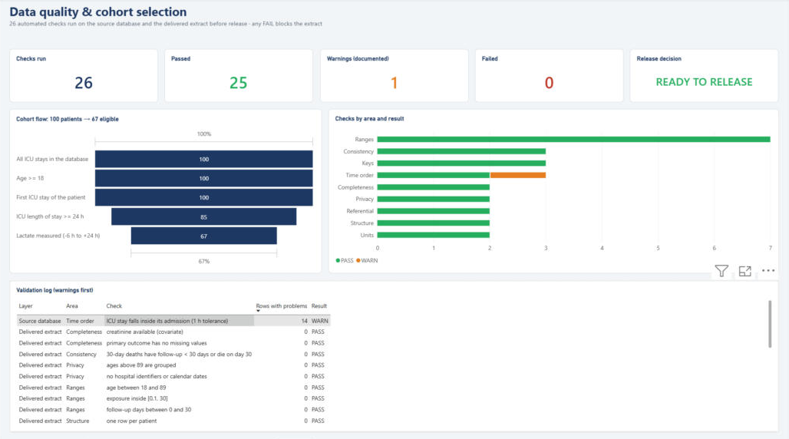

# 🏥 Clinical Research Data Desk

**An end-to-end research-data workflow on real (de-identified) hospital data**: a feasibility check for a research proposal, protocol-driven SQL extraction with de-identification, automated data validation, a statistical analysis, and a Power BI dashboard on a star-schema model, in Python, SQL and DAX.

It reproduces the work of a hospital research-data analyst: a researcher submits a study protocol, and the data team checks whether the study is feasible, extracts exactly the approved data, validates it and supports the analysis.

**Data:** [MIMIC-IV Clinical Database Demo v2.2](https://physionet.org/content/mimic-iv-demo/2.2/) – 100 de-identified ICU patients from Beth Israel Deaconess Medical Center (275 admissions, 140 ICU stays, 107,727 lab results).



---

## The study request

> **EMK-2026-014 (fictional proposal, written for this portfolio project):** Is a high blood lactate in the first 24 hours of an ICU stay associated with in-hospital mortality, after adjusting for age and sex?

The whole protocol (inclusion criteria, lab item IDs, time windows, plausible ranges, approved variables) lives in [`protocol/lactate_mortality.yaml`](protocol/lactate_mortality.yaml). No parameter is hard-coded in the SQL or Python, so a new study means a new YAML file.

## Workflow and results

| Step | What it does | Output |
|---|---|---|
| **1. Feasibility** | Applies the criteria one by one, counts patients and outcome events, checks events-per-variable and completeness, gives a verdict | [`01_feasibility.md`](reports/01_feasibility.md) |
| **2. Extraction** | One parameterised SQL query, then de-identification: study IDs replace hospital IDs (linkage key kept apart), dates become "days from ICU admission", ages over 89 grouped, only approved variables leave (minimum necessary) | extract CSV + [data dictionary](data/extract/EMK-2026-014_data_dictionary.md) |
| **3. Validation** | 26 automated checks on the source (keys, referential integrity, time order, units, ranges) and on the extract (privacy, structure, ranges). Any FAIL blocks release | [`02_validation.md`](reports/02_validation.md) |
| **4. Analysis** | Runs only on the delivered extract: Table 1 with significance tests, mortality by lactate band, ML and Firth logistic regression, Kaplan-Meier with log-rank test | [`03_analysis.md`](reports/03_analysis.md) |
| **5. BI export** | Builds a small star schema (patient fact + lactate-band, age-band and ICU-unit dimensions, plus cohort-flow and validation-log tables) for the dashboard. Bands and labels are decided once, in Python, so Power BI only aggregates | `bi/data/*.csv` → [Power BI project](bi/) |

### Key findings

- **Feasibility:** 100 patients → **67 eligible** (first ICU stay, ≥ 24 h, lactate measured). Only **7 in-hospital deaths**, 1.8 events per model term, so the verdict is *feasible with limitations*: a reduced model and Firth's penalised regression were used.
- **Dose-response:** in-hospital mortality was **5%** with lactate ≤ 2, **9%** at 2–4 and **21%** above 4 mmol/L.
- **Adjusted model:** each extra 1 mmol/L of lactate gave an OR of **1.30 (95% CI 0.97–1.74, p = 0.079)**. Lactate > 2: OR 2.36 (0.36–15.55). The direction matches the clinical literature, but the demo cohort is too small for significance.
- **Validation:** 0 failures. One documented warning: 14 ICU stays end up to 27 h after hospital discharge (a documentation lag that does not affect the first-24 h window).

<p>
  
  
  
</p>

## Power BI dashboard

A two-page report built as a **Power BI Project (PBIP)**, so the model and every measure are plain text and reviewable in git ([`bi/ClinicalResearchDesk.SemanticModel/definition/`](bi/ClinicalResearchDesk.SemanticModel/definition/)).

- **Model:** star schema with one-to-many relationships from `fact_patient` to three dimensions; band columns sorted by a hidden sort-order column, so "≤ 2 / 2–4 / > 4" never sorts alphabetically.
- **20 DAX measures**, e.g. `Mortality %`, `Risk Ratio (High vs Normal)` (`CALCULATE` with filter arguments), `Retained %` for the cohort funnel (`REMOVEFILTERS`), and `Release Decision` from the validation log.
- **A built-in caution:** the `Sample Size Note` measure warns when a slicer selection leaves fewer than 5 deaths, so the dashboard does not invite conclusions the data cannot support.
- **Page 1, Study overview:** KPIs, mortality by lactate band and age band, lactate vs ICU stay per patient, outcomes table, slicers for sex, admission type and ICU unit.
- **Page 2, Data quality:** all 26 validation checks, pass/warn/fail by area, the cohort funnel (100 → 67) and the release decision.



## Design decisions

- **Labs matched by patient + time window, not admission ID.** Results drawn in the ED before admission often have an empty `hadm_id`; joining on it would silently drop them.
- **One ICU stay per patient** (the first), so observations are independent.
- **Plausible-range filtering** in the SQL, with rejected values counted and reported, never silently dropped.
- **Firth logistic regression** alongside standard maximum likelihood: with few events, standard estimates are biased away from 1 and can fail to converge.
- **Analysis reads only the extract**, exactly like an external researcher, so every result can be reproduced from the delivered file.
- **Statistics implemented with NumPy/SciPy** (logistic regression, Firth correction, Kaplan-Meier, log-rank, Wilson CI) and checked by [unit tests](tests/test_stats_utils.py) against independent references: scikit-learn, SciPy's log-rank and Wilson interval, a direct optimisation of Firth's penalised likelihood, and hand-worked examples. Tests run on every push (GitHub Actions).

## Project structure

```
clinical-research-data/
├── protocol/lactate_mortality.yaml   # the research proposal as parameters
├── sql/candidate_stays.sql           # parameterised cohort query, one flag per criterion
├── src/
│   ├── load_data.py                  # 0. ZIP → SQLite (reads straight from the ZIP)
│   ├── feasibility.py                # 1. criteria flow, events, EPV, verdict
│   ├── extract.py                    # 2. de-identified, minimum-necessary extract
│   ├── validate.py                   # 3. source + extract checks, release gate
│   ├── analysis.py                   # 4. Table 1, regression, survival, figures
│   ├── export_bi.py                  # 5. star schema for Power BI
│   ├── stats_utils.py                # logistic / Firth / Kaplan-Meier / log-rank / Wilson
│   └── common.py
├── bi/
│   ├── ClinicalResearchDesk.pbip     # open in Power BI Desktop
│   ├── ClinicalResearchDesk.SemanticModel/   # tables, relationships, DAX (TMDL)
│   ├── ClinicalResearchDesk.Report/          # report pages (PBIR)
│   ├── make_report.py                # generates the report pages from a layout spec
│   └── data/                         # star-schema CSVs written by step 5
├── tests/test_stats_utils.py
├── reports/                          # generated reports and figures
└── run_pipeline.py
```

## Run it

1. Download the ZIP from the [MIMIC-IV demo page](https://physionet.org/content/mimic-iv-demo/2.2/) (open access) into `data/raw/`. Don't unzip it.
2. Run:

```bash
pip install -r requirements.txt
python run_pipeline.py              # all steps
python run_pipeline.py feasibility  # or a single step
pytest                              # unit tests (pip install -r requirements-dev.txt)
```

3. Open `bi/ClinicalResearchDesk.pbip` in Power BI Desktop. If your folder differs, set the `DataFolder` parameter (Transform data → Edit parameters) to your `bi/data` path and press Refresh.

## Data licence

MIMIC-IV Clinical Database Demo is available under the Open Data Commons Open Database License v1.0. Raw data and patient-level extracts are not committed to this repository.

The study proposal, investigator and approval in this project are fictional. The project is a personal portfolio piece and is not affiliated with, or endorsed by, any hospital or research institution.

> Johnson, A., Bulgarelli, L., Pollard, T., Horng, S., Celi, L. A., & Mark, R. (2023). *MIMIC-IV Clinical Database Demo* (version 2.2). PhysioNet. https://doi.org/10.13026/dp1f-ex47
