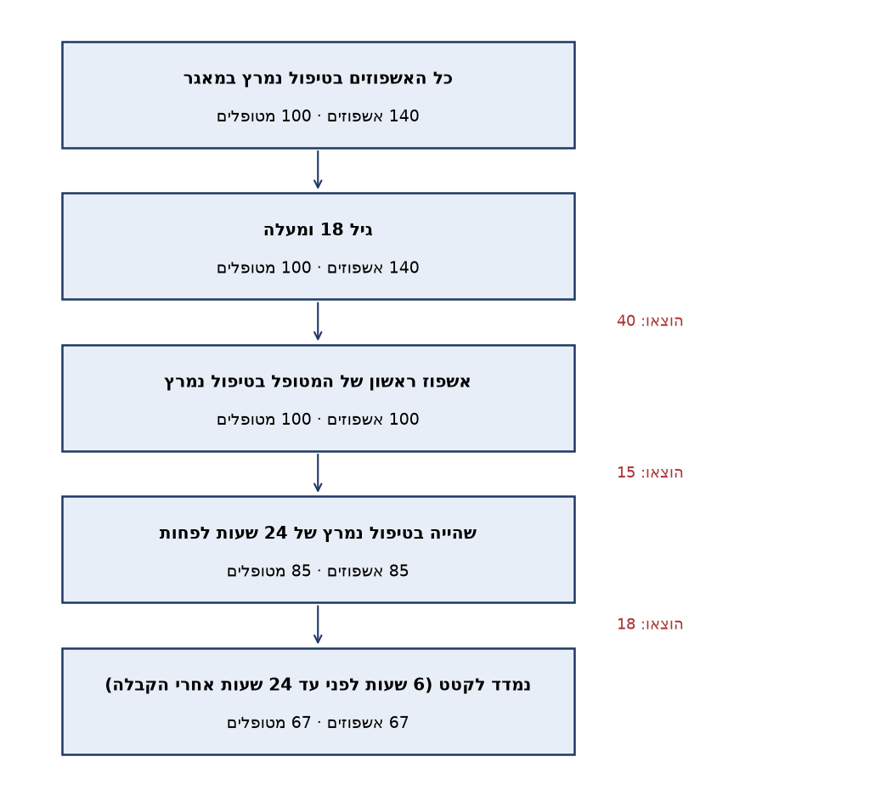

# בדיקת היתכנות (Feasibility) - EMK-2026-014

**המחקר:** Early hyperlactatemia and in-hospital mortality in adult ICU patients
**מבקש הבדיקה:** Dr. A. Researcher (fictional)
**תאריך הבדיקה:** 2026-11-09 · **מקור הנתונים:** MIMIC-IV Clinical Database Demo v2.2

## המלצה (Verdict)

**ישים בהסתייגויות: יש רק 7 אירועים ל-4 משתנים במודל, כלומר 1.8 אירועים למשתנה (Events per variable, EPV), הרבה מתחת לסף המקובל של 10. ההמלצה היא לצמצם את המודל (חשיפה + גיל), להשתמש בשיטה מדויקת או ברגרסיה עם ענישה (Firth), או להריץ את המחקר על מאגר MIMIC-IV המלא.**

## זרימת הקוהורט (Cohort flow)

| שלב | אשפוזים בטיפול נמרץ (ICU) | מטופלים | הוצאו בשלב זה |
|---|---|---|---|
| כל האשפוזים בטיפול נמרץ במאגר | 140 | 100 | 0 |
| גיל 18 ומעלה | 140 | 100 | 0 |
| אשפוז ראשון של המטופל בטיפול נמרץ | 100 | 100 | 40 |
| שהייה בטיפול נמרץ של 24 שעות לפחות | 85 | 85 | 15 |
| נמדד לקטט (6 שעות לפני עד 24 שעות אחרי הקבלה) | 67 | 67 | 18 |

## חשיפה ותוצאה

| מדד | ערך |
|---|---|
| מטופלים שעומדים בקריטריונים | 67 |
| לקטט > 2.0 mmol/L ב-24 השעות הראשונות | 47 (70%) |
| פטירות במהלך האשפוז (תוצאה ראשית) | 7 (10%) |
| משתנים מתוכננים במודל (חשיפה + משתנים מתקננים) | 4 |
| אירועים למשתנה (EPV) | 1.8 (כלל אצבע: 10 לפחות) |

## שלמות המשתנים בקוהורט

| משתנה | זמינים | % שלמות |
|---|---|---|
| age | 67 | 100.0 |
| sex | 67 | 100.0 |
| max_lactate_24h | 67 | 100.0 |
| max_creatinine_24h | 67 | 100.0 |
| in_hospital_death | 67 | 100.0 |
| dod (תוצאת 30 יום) | 67 | 100.0 |

## הערות לחוקר

- ערכי הלקטט נלקחים מבדיקות גזים בדם (itemid 50813). ערכים מחוץ לטווח
  [0.1, 30] mmol/L נפסלים כבלתי סבירים
  (בסך הכול נפסלו 0 תוצאות בכל האשפוזים).
- בדיקות המעבדה מותאמות לפי מטופל וחלון זמן, ולא לפי מספר אשפוז: בדיקות שנלקחו במיון לפני הקבלה
  לאשפוז הן לעיתים קרובות ללא מספר אשפוז, וצירוף לפיו היה משמיט אותן בשקט.
- נכלל רק האשפוז הראשון של כל מטופל בטיפול נמרץ, כך שכל מטופל מופיע פעם אחת והתצפיות בלתי תלויות.

