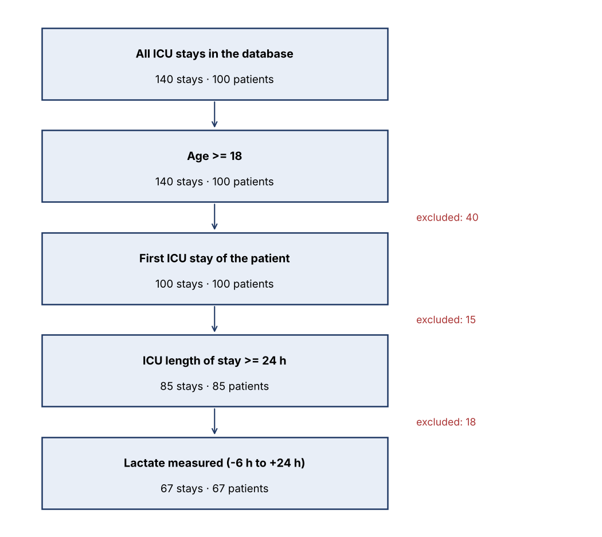

# Feasibility check - EMK-2026-014

**Study:** Early hyperlactatemia and in-hospital mortality in adult ICU patients
**Requested by:** Dr. A. Researcher (fictional)
**Checked on:** 2026-10-29 · **Source:** MIMIC-IV Clinical Database Demo v2.2

## Verdict

**FEASIBLE WITH LIMITATIONS - 7 events for 4 model terms (1.8 events per variable, below the usual 10). Recommend a reduced model (exposure + age), exact/penalised methods, or running the study on the full MIMIC-IV database.**

## Cohort flow

| Step | ICU stays | Patients | Excluded at this step |
|---|---|---|---|
| All ICU stays in the database | 140 | 100 | 0 |
| Age >= 18 | 140 | 100 | 0 |
| First ICU stay of the patient | 100 | 100 | 40 |
| ICU length of stay >= 24 h | 85 | 85 | 15 |
| Lactate measured (-6 h to +24 h) | 67 | 67 | 18 |

## Exposure and outcome

| Measure | Value |
|---|---|
| Eligible patients | 67 |
| Lactate > 2.0 mmol/L in first 24 h | 47 (70%) |
| In-hospital deaths (primary outcome) | 7 (10%) |
| Model terms planned (exposure + covariates) | 4 |
| Events per variable | 1.8 (rule of thumb: >= 10) |

## Variable completeness in the eligible cohort

| variable | available | % complete |
|---|---|---|
| age | 67 | 100.0 |
| sex | 67 | 100.0 |
| max_lactate_24h | 67 | 100.0 |
| max_creatinine_24h | 67 | 100.0 |
| in_hospital_death | 67 | 100.0 |
| dod (30-day outcome) | 67 | 100.0 |

## Notes for the researcher

- Lactate is taken from blood-gas results (itemid 50813); values outside
  [0.1, 30] mmol/L are rejected as implausible
  (0 result(s) rejected across all stays).
- Labs are matched by patient and time window, because results drawn in the ED before admission
  often have no admission ID.
- Only the first ICU stay per patient is used, so each patient appears once.
