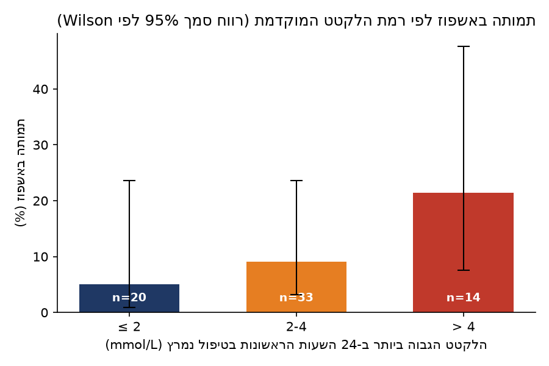
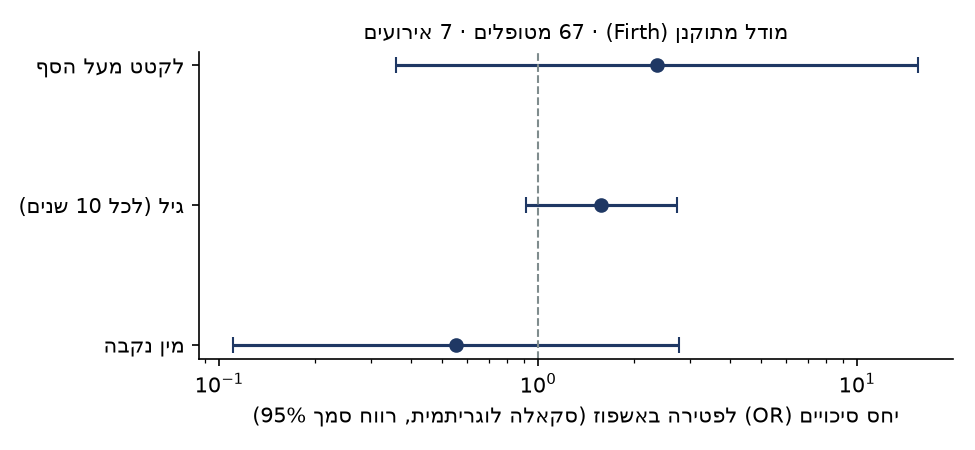
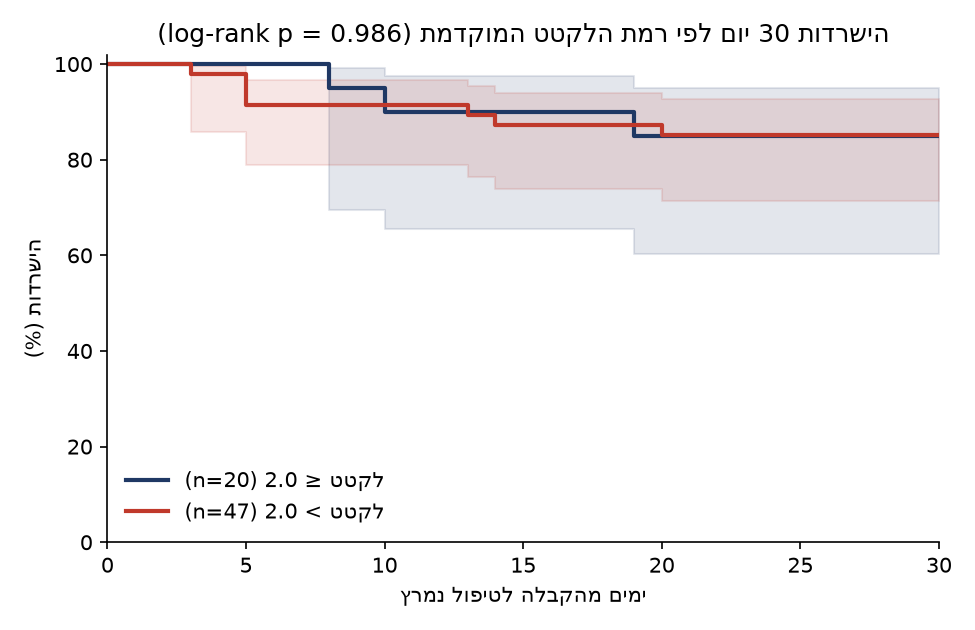

# ניתוח סטטיסטי (Analysis) - EMK-2026-014

**שאלת המחקר:** האם רמת לקטט גבוהה בדם ב-24 השעות הראשונות של שהייה בטיפול נמרץ קשורה לתמותה במהלך האשפוז, לאחר תקנון לגיל ולמין?

**נתונים:** קובץ חילוץ לאחר הסרת מזהים (De-identified extract) `EMK-2026-014_extract.csv`
(67 מטופלים, 7 פטירות באשפוז).

## ממצאים עיקריים

- למטופלים עם לקטט > 2.0 mmol/L היה יחס סיכויים (Odds ratio, OR) מתוקנן לפטירה באשפוז של
  **2.36 (רווח סמך 95% (95% CI) 0.36-15.55, p = 0.371)**
  (רגרסיה לוגיסטית (Logistic regression) לפי Firth, מתוקננת לגיל ולמין).
- כל עלייה של 1 mmol/L בלקטט: OR של **1.30 (0.97-1.74, p = 0.079)**.
- הישרדות 30 יום לפי קבוצה: מבחן log-rank, chi-square = 0.00, p = 0.986 (לא מובהק סטטיסטית ברמה של 0.05).
- עם 7 אירועים בלבד האומדנים לא מדויקים, ורווחי הסמך רחבים. זו הדגמה על מאגר הדמו של
  100 מטופלים; אותו פייפליין רץ בלי שינוי על מאגר MIMIC-IV המלא.

## טבלה 1 (Table 1) - מאפייני המטופלים לפי רמת הלקטט המוקדמת

| מאפיין | כלל המטופלים | לקטט ≤ 2.0 | לקטט > 2.0 | p |
|---|---|---|---|---|
| מטופלים, n | 67 | 20 | 47 |  |
| גיל, חציון [טווח בין-רבעוני, IQR] | 62.0 [49.0-71.5] | 61.0 [53.5-73.5] | 63.0 [47.5-70.0] | 0.565 |
| נשים, n (%) | 29 (43%) | 10 (50%) | 19 (40%) | 0.592 |
| קבלה דחופה (Emergency), n (%) | 33 (49%) | 9 (45%) | 24 (51%) | 0.791 |
| לקטט מרבי ב-24 שעות, mmol/L | 2.7 [1.9-3.6] | 1.6 [1.0-1.7] | 3.1 [2.6-4.5] | <0.001 |
| קריאטינין מרבי ב-24 שעות, mg/dL | 1.0 [0.7-1.7] | 0.9 [0.7-1.7] | 1.0 [0.8-1.9] | 0.175 |
| משך שהייה בטיפול נמרץ (ICU), ימים | 3.5 [1.9-5.8] | 2.4 [1.4-3.7] | 4.5 [2.3-6.5] | 0.042 |
| פטירה באשפוז, n (%) | 7 (10%) | 1 (5%) | 6 (13%) | 0.665 |
| פטירה תוך 30 יום, n (%) | 10 (15%) | 3 (15%) | 7 (15%) | 1.000 |

משתנים רציפים: חציון [IQR], מבחן Mann-Whitney U. משתנים קטגוריאליים: n (%), המבחן המדויק של Fisher.

## תמותה לפי טווח לקטט

| טווח לקטט (mmol/L) | מטופלים | פטירות | תמותה | רווח סמך 95% |
|---|---|---|---|---|
| ≤ 2 | 20 | 1 | 5% | 1-24% |
| 2-4 | 33 | 3 | 9% | 3-24% |
| > 4 | 14 | 3 | 21% | 8-48% |

## רגרסיה לוגיסטית - פטירה באשפוז

**ללא תקנון** (נראות מרבית):

| משתנה | יחס סיכויים (OR) | רווח סמך 95% | p |
|---|---|---|---|
| לקטט מעל הסף | 2.78 | 0.31-24.74 | 0.359 |

**מתוקנן, נראות מרבית (Maximum likelihood):**

| משתנה | יחס סיכויים (OR) | רווח סמך 95% | p |
|---|---|---|---|
| לקטט מעל הסף | 3.42 | 0.36-32.74 | 0.287 |
| גיל (לכל 10 שנים) | 1.73 | 0.92-3.28 | 0.090 |
| מין נקבה | 0.45 | 0.07-2.77 | 0.386 |

**מתוקנן, נראות מרבית עם ענישה לפי Firth (Firth penalised likelihood)** (השיטה המועדפת כשיש מעט אירועים):

| משתנה | יחס סיכויים (OR) | רווח סמך 95% | p |
|---|---|---|---|
| לקטט מעל הסף | 2.36 | 0.36-15.55 | 0.371 |
| גיל (לכל 10 שנים) | 1.58 | 0.91-2.72 | 0.101 |
| מין נקבה | 0.55 | 0.11-2.77 | 0.472 |

**לקטט כמשתנה רציף** (Firth):

| משתנה | יחס סיכויים (OR) | רווח סמך 95% | p |
|---|---|---|---|
| לקטט (לכל 1 mmol/L) | 1.30 | 0.97-1.74 | 0.079 |
| גיל (לכל 10 שנים) | 1.54 | 0.86-2.74 | 0.144 |
| מין נקבה | 0.49 | 0.09-2.68 | 0.410 |

## הישרדות 30 יום

## מגבלות

- מדגם קטן (67 מטופלים, 7 אירועים): עוצמה סטטיסטית נמוכה ורווחי סמך רחבים.
- קריאטינין תוכנן כמשתנה מתקנן, אבל לא נכלל במודל הראשי כדי לשמור על יחס סביר של אירועים
  למשתנה (ראו את דוח בדיקת ההיתכנות).
- נתונים תצפיתיים: לקטט נמדד כשהצוות הקליני חושד בבעיה, ולכן עצם ההחלטה למדוד קשורה לחומרת
  המצב (הטיית הוריה, Confounding by indication).

