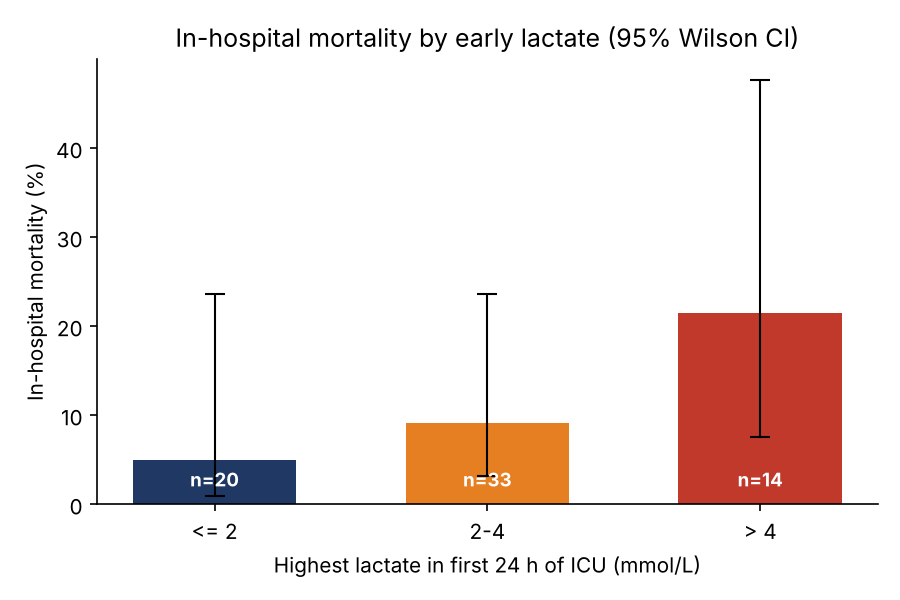
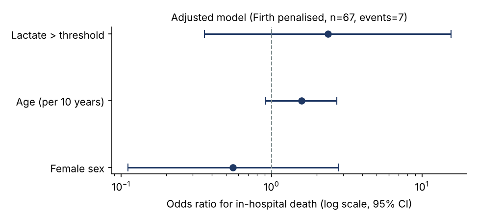
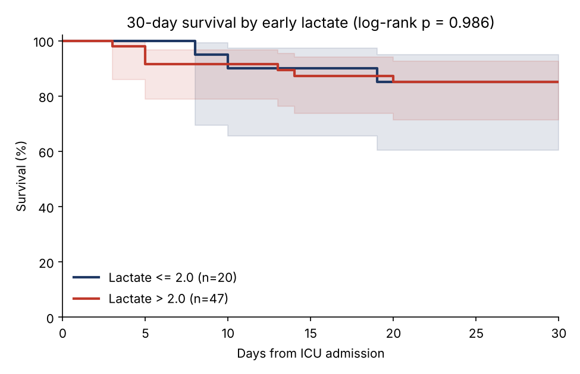

# Analysis - EMK-2026-014

**Question:** Is a high blood lactate in the first 24 hours of an ICU stay associated with in-hospital mortality, after adjusting for age and sex?

**Data:** de-identified extract `EMK-2026-014_extract.csv` (67 patients, 7 in-hospital deaths).

## Key findings

- Patients with lactate > 2.0 mmol/L had an adjusted odds ratio for in-hospital death of
  **2.36 (95% CI 0.36-15.55, p = 0.371)**
  (Firth logistic regression, adjusted for age and sex).
- Each additional 1 mmol/L of lactate: OR **1.30 (0.97-1.74, p = 0.079)**.
- 30-day survival by group: log-rank chi-square = 0.00, p = 0.986 (not statistically significant at 0.05).
- With 7 events the estimates are imprecise (wide CIs). This is a demonstration on the
  100-patient demo database; the same pipeline runs unchanged on the full MIMIC-IV database.

## Table 1 - characteristics by early lactate

| Characteristic | All | Lactate <= 2.0 | Lactate > 2.0 | p |
|---|---|---|---|---|
| Patients, n | 67 | 20 | 47 |  |
| Age, median [IQR] | 62.0 [49.0-71.5] | 61.0 [53.5-73.5] | 63.0 [47.5-70.0] | 0.565 |
| Female, n (%) | 29 (43%) | 10 (50%) | 19 (40%) | 0.592 |
| Emergency admission, n (%) | 33 (49%) | 9 (45%) | 24 (51%) | 0.791 |
| Max lactate 24 h, mmol/L | 2.7 [1.9-3.6] | 1.6 [1.0-1.7] | 3.1 [2.6-4.5] | <0.001 |
| Max creatinine 24 h, mg/dL | 1.0 [0.7-1.7] | 0.9 [0.7-1.7] | 1.0 [0.8-1.9] | 0.175 |
| ICU length of stay, days | 3.5 [1.9-5.8] | 2.4 [1.4-3.7] | 4.5 [2.3-6.5] | 0.042 |
| In-hospital death, n (%) | 7 (10%) | 1 (5%) | 6 (13%) | 0.665 |
| Death within 30 days, n (%) | 10 (15%) | 3 (15%) | 7 (15%) | 1.000 |

Continuous variables: median [IQR], Mann-Whitney U test. Categorical: n (%), Fisher's exact test.

## Mortality by lactate band

| Lactate band (mmol/L) | Patients | Deaths | Mortality | 95% CI |
|---|---|---|---|---|
| <= 2 | 20 | 1 | 5% | 1-24% |
| 2-4 | 33 | 3 | 9% | 3-24% |
| > 4 | 14 | 3 | 21% | 8-48% |

## Logistic regression - in-hospital death

**Unadjusted** (Maximum likelihood):

| Term | Odds ratio | 95% CI | p |
|---|---|---|---|
| Lactate > threshold | 2.78 | 0.31-24.74 | 0.359 |

**Adjusted, maximum likelihood:**

| Term | Odds ratio | 95% CI | p |
|---|---|---|---|
| Lactate > threshold | 3.42 | 0.36-32.74 | 0.287 |
| Age (per 10 years) | 1.73 | 0.92-3.28 | 0.090 |
| Female sex | 0.45 | 0.07-2.77 | 0.386 |

**Adjusted, Firth penalised likelihood** (preferred with few events):

| Term | Odds ratio | 95% CI | p |
|---|---|---|---|
| Lactate > threshold | 2.36 | 0.36-15.55 | 0.371 |
| Age (per 10 years) | 1.58 | 0.91-2.72 | 0.101 |
| Female sex | 0.55 | 0.11-2.77 | 0.472 |

**Lactate as a continuous variable** (Firth):

| Term | Odds ratio | 95% CI | p |
|---|---|---|---|
| Lactate (per 1 mmol/L) | 1.30 | 0.97-1.74 | 0.079 |
| Age (per 10 years) | 1.54 | 0.86-2.74 | 0.144 |
| Female sex | 0.49 | 0.09-2.68 | 0.410 |

## 30-day survival

## Limitations

- Small sample (67 patients, 7 events): low power and wide confidence intervals.
- Creatinine was planned as a covariate but is left out of the main model to keep the
  events-per-variable ratio reasonable (see the feasibility report).
- Observational data: lactate is measured when clinicians suspect a problem, so who gets
  tested is itself related to severity (confounding by indication).
